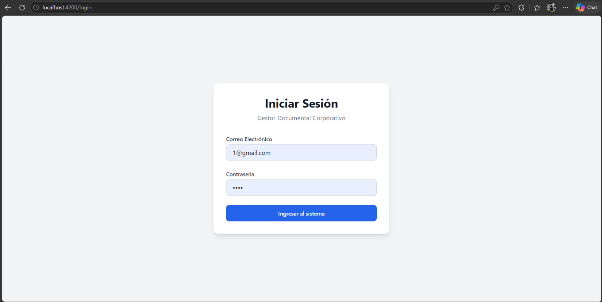
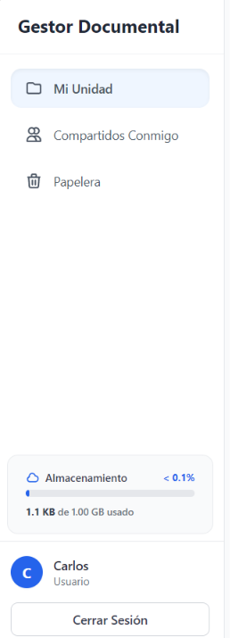
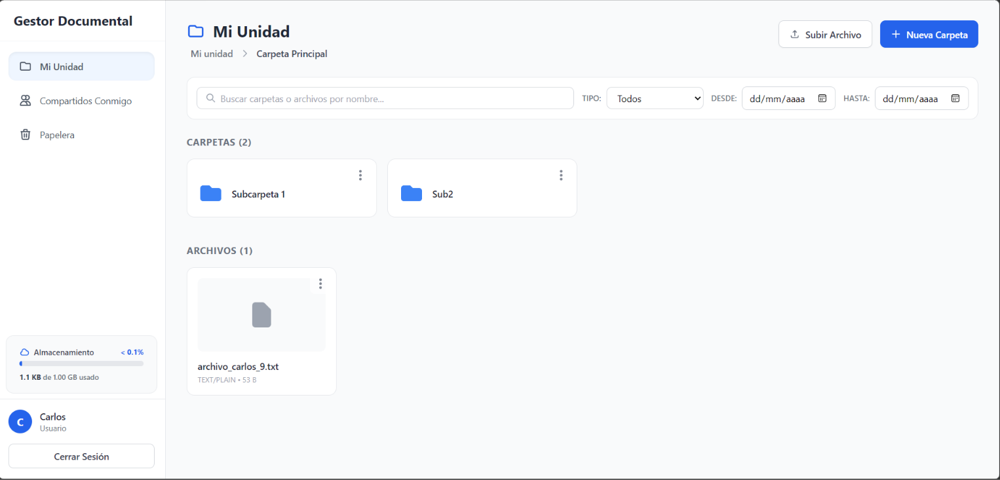
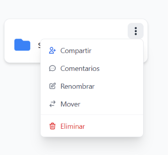
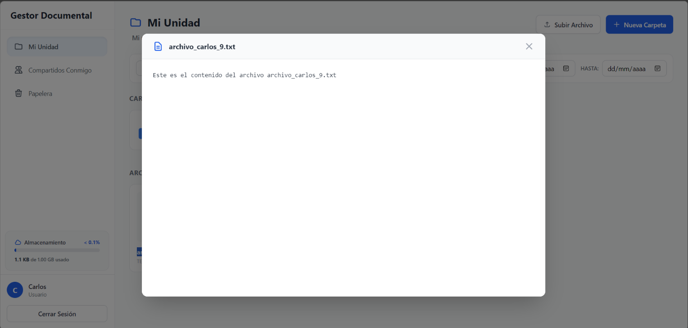
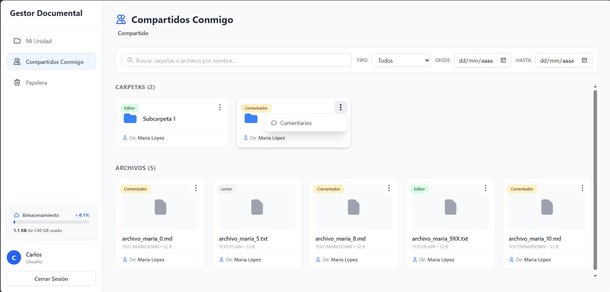
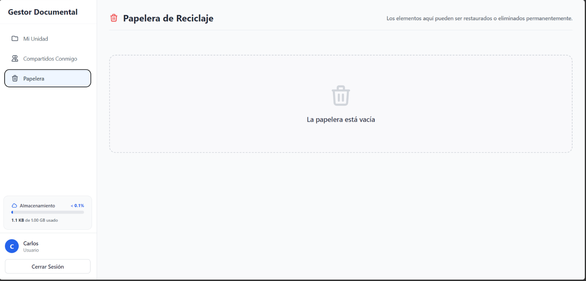
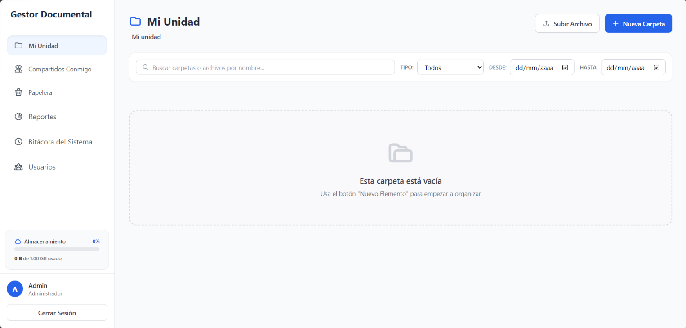
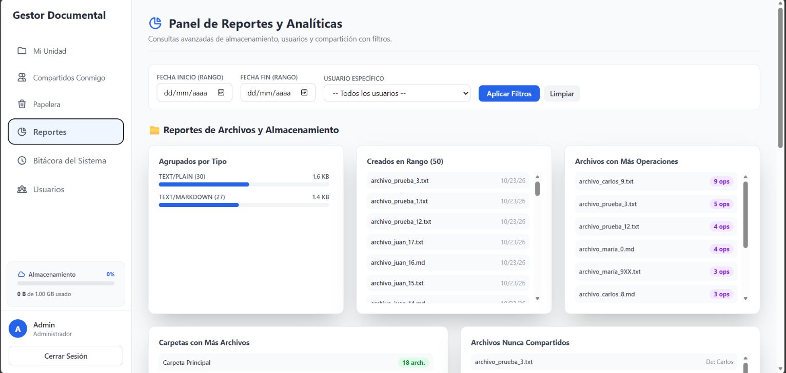
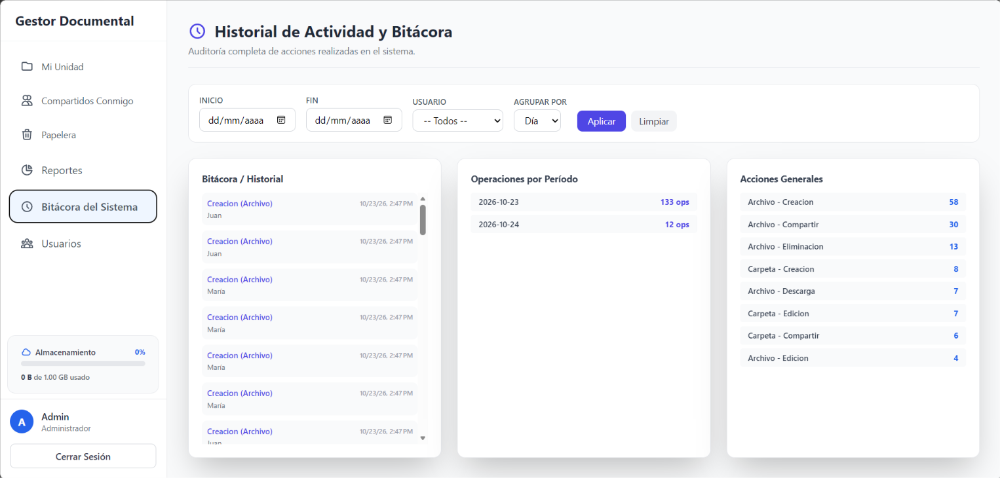

# MANUAL DE USUARIO
## Sistema de Gestión Documental

---

## Índice
1. [Introducción](#1-introducción)
2. [Acceso al Sistema](#2-acceso-al-sistema)
3. [Interfaz Principal y Navegación](#3-interfaz-principal-y-navegación)
4. [Mi Unidad (Gestión de Archivos y Carpetas)](#4-mi-unidad)
5. [Compartidos Conmigo (Colaboración)](#5-compartidos-conmigo)
6. [Papelera de Reciclaje](#6-papelera)
7. [Panel de Administrador (Reportes y Bitácora)](#7-panel-de-administrador)

---

### 1. Introducción
Bienvenido al **Sistema de Gestión Documental**. Esta plataforma está diseñada para facilitar el almacenamiento, organización, previsualización y colaboración de documentos en la nube. Permite a los usuarios mantener sus archivos seguros y compartirlos de manera controlada con otros miembros del equipo.

### 2. Acceso al Sistema
Para ingresar a la plataforma:
1. Abra su navegador web e ingrese a la dirección del sistema.
2. En la pantalla de inicio de sesión, introduzca su **Correo electrónico** y **Contraseña**.
3. Haga clic en el botón **"Ingresar"**.
*(Nota: Si no recuerda sus credenciales o no tiene cuenta, solicite el acceso al administrador del sistema).*

### 3. Interfaz Principal y Navegación
Al ingresar, encontrará un panel lateral izquierdo (Menú de Navegación) que le permitirá moverse entre los distintos módulos del sistema:

*   **Mi Unidad:** Su espacio personal de almacenamiento.
*   **Compartidos Conmigo:** Archivos y carpetas que otros usuarios le han dado permiso para ver o editar.
*   **Papelera:** Elementos que usted ha eliminado temporalmente.
*   *(Solo Administradores)* **Reportes:** Estadísticas de uso y almacenamiento.
*   *(Solo Administradores)* **Bitácora del Sistema:** Historial completo de actividades.
*   *(Solo Administradores)* **Usuarios:** Gestión de cuentas.

En la esquina inferior izquierda encontrará un **indicador de almacenamiento** que muestra el espacio utilizado y su cuota disponible, junto con el botón para **Cerrar Sesión**.

### 4. Mi Unidad
Este es su espacio de trabajo principal. En la parte superior, verá la barra de ruta (*breadcrumbs*) que le indicará exactamente en qué carpeta se encuentra y le permitirá retroceder fácilmente.

#### 4.1. Crear y Subir Elementos
*   **Nueva Carpeta:** Haga clic en el botón azul "Nueva Carpeta" en la esquina superior derecha, escriba el nombre y confirme.
*   **Subir Archivo:** Haga clic en el botón "Subir Archivo". Se abrirá el explorador de su computadora para que seleccione el documento que desea almacenar.

#### 4.2. Acciones sobre los Archivos/Carpetas
Cada tarjeta de archivo o carpeta tiene un botón de tres puntos (**⋮**) que abre un menú de opciones:
*   **Renombrar:** Cambia el nombre del elemento.
*   **Mover:** Le permite trasladar el elemento a otra carpeta dentro de su unidad. Se abrirá una ventana para que navegue y elija el nuevo destino.
*   **Compartir:** Le permite dar acceso a otros usuarios. Puede otorgar permisos de **Lectura** (solo ver/descargar) o **Edición** (modificar).
*   **Ver Comentarios:** Abre un panel lateral para dejar notas o ver las discusiones sobre ese archivo específico.
*   **Descargar (Archivos):** Guarda una copia del archivo en su computadora local.
*   **Enviar a Papelera:** Elimina el elemento de su vista principal (puede recuperarse después).

#### 4.3. Previsualización Rápida
Si hace **doble clic** sobre un archivo de texto (`.txt` o `.md`), se abrirá el **Visor de Archivos** integrado, permitiéndole leer el contenido directamente en el navegador sin necesidad de descargarlo.

### 5. Compartidos Conmigo
En esta sección encontrará todo el material al que ha sido invitado. 
*   **Buscador y Filtros:** Utilice la barra superior para buscar elementos por nombre, filtrar por tipo (Texto, Markdown) o por fechas de creación.
*   **Niveles de Permiso:** Podrá realizar acciones dependiendo del permiso otorgado. Si es "Lector", no podrá mover ni renombrar el archivo; si es "Editor", tendrá más libertades.
*   **Quitar Acceso:** Si ya no desea ver un archivo compartido en su bandeja, puede seleccionar la opción "Quitar Acceso" desde el menú desplegable (⋮).

### 6. Papelera
Aquí residen los elementos que ha eliminado.
*   **Restaurar:** Devuelve el archivo o carpeta a su ubicación original.
*   **Eliminar Definitivamente:** Borra el elemento de forma permanente, liberando el espacio en su cuota de almacenamiento. *(Atención: esta acción no se puede deshacer).*

### 7. Panel de Administrador
*Esta sección solo es visible para usuarios con rol de Administrador.*

#### 7.1. Reportes
Módulo de inteligencia de negocios y analíticas del sistema. Cuenta con filtros globales por fecha y usuario específico.
*   **Reportes de Archivos:** Gráficas de espacio consumido, agrupación por tipo de archivo, archivos más activos y las carpetas más pesadas.
*   **Reportes de Usuarios:** Top de usuarios con más archivos y listado de los usuarios que más comparten información.
*   **Reportes de Compartición:** Muestra los archivos virales (compartidos con muchos usuarios) y el detalle exacto de qué ha compartido y qué ha recibido un usuario en específico.

#### 7.2. Bitácora del Sistema (Auditoría)
Muestra un registro inmutable de todo lo que ocurre en la plataforma.
*   Permite filtrar y ver qué usuario realizó una acción (ej. "Edición de archivo", "Eliminación", "Descarga") junto con la fecha y hora exacta.
*   Incluye contadores estadísticos de operaciones por período (Día/Mes) y el volumen de acciones generales del sistema.

