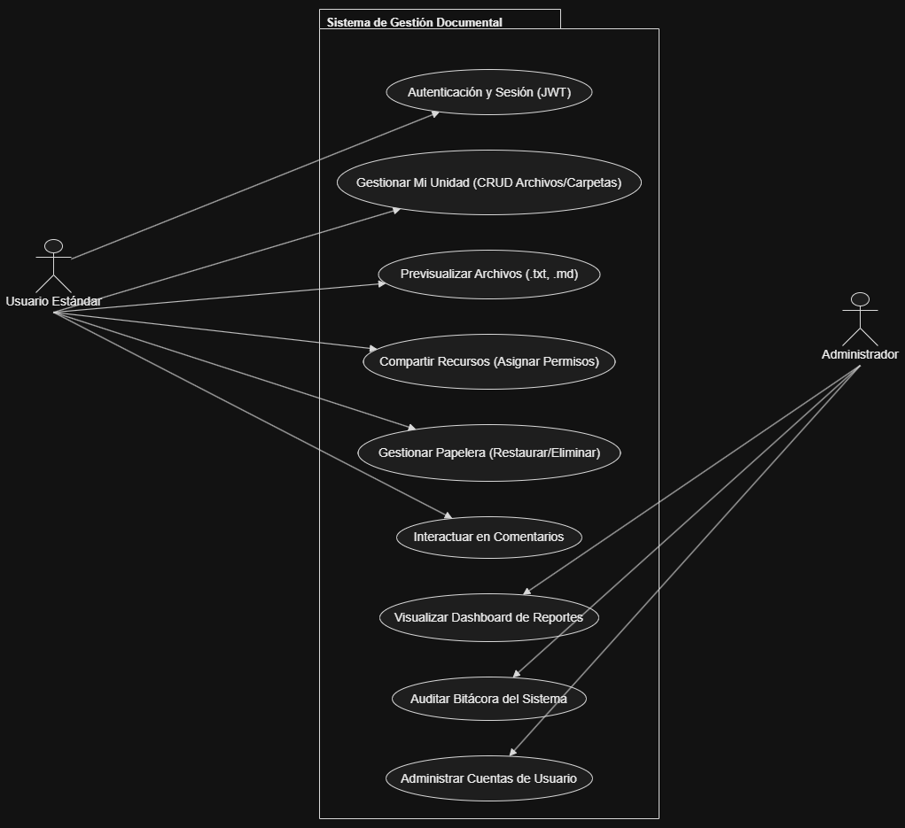
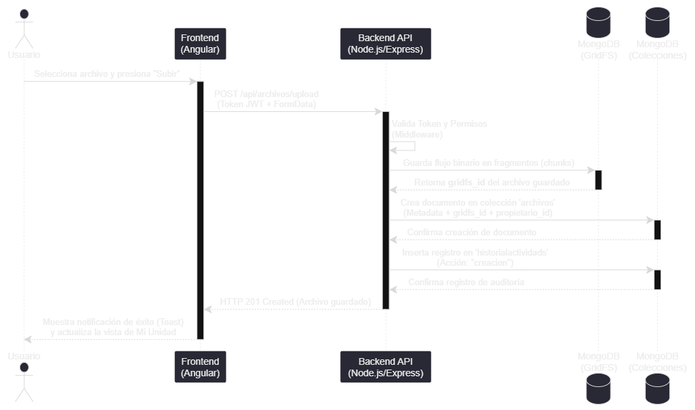
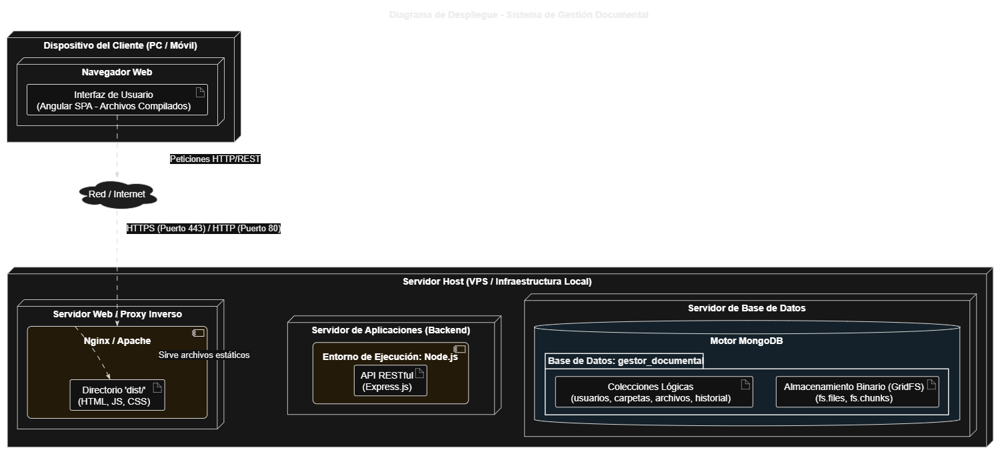

# MANUAL TÉCNICO
## Sistema de Gestión Documental

---

## Índice
1. [Introducción](#1-introducción)
2. [Objetivos del Sistema](#2-objetivos-del-sistema)
3. [Arquitectura del Sistema](#3-arquitectura-del-sistema)
4. [Stack Tecnológico](#4-stack-tecnológico)
5. [Modelo de Base de Datos (NoSQL)](#5-modelo-de-base-de-datos-nosql)
6. [Diseño de la API REST](#6-diseño-de-la-api-rest)
7. [Seguridad y Control de Accesos](#7-seguridad-y-control-de-accesos)
8. [Configuración y Despliegue](#8-configuración-y-despliegue)

---

### 1. Introducción
El presente manual técnico documenta la estructura, diseño y funcionamiento interno del **Sistema de Gestión Documental**. Este sistema ha sido desarrollado para administrar de forma centralizada la carga, organización, compartición y auditoría de archivos digitales, utilizando tecnologías web modernas bajo un enfoque de alta escalabilidad y rendimiento.

### 2. Objetivos del Sistema
*   Proveer un entorno seguro para el almacenamiento de archivos mediante fragmentación binaria.
*   Implementar un sistema de control de acceso granular (lectura, edición, comentarios).
*   Mantener una trazabilidad completa de las acciones del usuario (bitácora de auditoría).
*   Ofrecer un panel analítico en tiempo real para administradores (reportes de almacenamiento, usuarios y compartición).

### 3. Arquitectura del Sistema
El sistema emplea un patrón de arquitectura **Cliente-Servidor** desacoplado, comunicándose a través de peticiones HTTP sobre una API RESTful.

*   **Capa de Presentación (Frontend):** Aplicación de Página Única (SPA) que gestiona la interfaz de usuario, el enrutamiento del lado del cliente y el consumo asíncrono de servicios.
*   **Capa de Lógica de Negocio (Backend):** Servidor sin estado (stateless) que procesa la lógica transaccional, validación de tokens de seguridad y la orquestación de operaciones de archivos.
*   **Capa de Datos:** Base de datos orientada a documentos que garantiza la persistencia, integridad referencial simulada y almacenamiento de archivos binarios pesados.

### 4. Stack Tecnológico
*   **Frontend:**
    *   **Framework:** Angular (v21.2.9)
    *   **Estilos:** Tailwind CSS (para diseño responsivo y sistema de grillas).
    *   **Librerías:** RxJS (programación reactiva), Angular Router.
*   **Backend:**
    *   **Entorno:** Node.js
    *   **Framework:** Express.js
    *   **ODM:** Mongoose
*   **Base de Datos:**
    *   **Motor:** MongoDB
    *   **Almacenamiento de Archivos:** GridFS (para superar el límite de 16MB por documento BSON).

### 5. Modelo de Base de Datos (NoSQL)
El modelo documental utiliza un diseño híbrido (referencias lógicas y documentos embebidos) para optimizar el rendimiento de las operaciones de lectura (OLTP) y generación de reportes (OLAP).

*   **`usuarios`**: Entidad principal. Almacena identidad, credenciales y cuotas de disco.
*   **`carpetas`**: Usa el patrón de Referencia al Padre (`carpeta_padre_id`) para construir árboles de directorios dinámicos. Embebe los arreglos de `accesos` y `comentarios`.
*   **`archivos`**: Contiene la metadata. Referencia a la colección `fs.files` de GridFS para ubicar el flujo binario. Embebe `accesos` y `comentarios`.
*   **`historialactividads`**: Colección transaccional independiente con referencias polimórficas (`recurso_id` y `tipo_recurso`) que registra la bitácora sin engordar los documentos raíz.

### 6. Diseño de la API REST
La comunicación se realiza a través de endpoints seguros en formato JSON. A continuación, los controladores principales:

*   **Auth (`/api/auth`)**:
    *   `POST /login`: Autenticación y generación de JWT.
*   **Carpetas (`/api/carpetas`)**:
    *   `POST /`: Crea una nueva carpeta en un nodo específico.
    *   `GET /:id`: Obtiene el contenido anidado de un directorio.
    *   `PUT /:id/mover`: Actualiza el `carpeta_padre_id`.
*   **Archivos (`/api/archivos`)**:
    *   `POST /upload`: Carga de archivos mediante *Multipart/form-data* (procesado hacia GridFS).
    *   `GET /:id/descargar`: Retorna el buffer binario del archivo (Blob).
    *   `POST /:id/comentarios`: Inserta un subdocumento en el arreglo de comentarios.
*   **Reportes (`/api/reportes`)**:
    *   `GET /archivos`: Retorna agregaciones ($group, $match) de almacenamiento.
    *   `GET /actividad`: Retorna la bitácora procesada para gráficas.

### 7. Seguridad y Control de Accesos
*   **Autenticación (JWT):** Cada inicio de sesión exitoso emite un *JSON Web Token* firmado con una clave secreta. El frontend lo adjunta en los encabezados (`Authorization: Bearer <token>`) de cada petición.
*   **Cifrado de Contraseñas:** Se utiliza `bcrypt` con un *salt* de 10 rondas para almacenar de forma irreversible las contraseñas de los usuarios.
*   **Autorización Híbrida (Middlewares):**
    *   *Nivel de Rutas:* Restricción de acceso general (ej. El módulo de `/reportes` exige rol `administrador`).
    *   *Nivel de Documento:* Restricción sobre recursos específicos validando que el `usuario_id` exista dentro del arreglo embebido de `accesos` con nivel de `edicion` o `propietario`.

### 8. Configuración y Despliegue

#### 8.1 Requisitos del Sistema
*   Node.js (v22 o superior).
*   MongoDB (v7.0.45 o superior) corriendo localmente o en MongoDB Atlas.
*   Angular CLI instalado globalmente (`npm install -g @angular/cli`).

#### 8.2 Variables de Entorno (Backend)
Crear un archivo `.env` en el directorio raíz del backend:
```env
PORT=3000
MONGODB_URI=mongodb://127.0.0.1:27017/gestor_documental
JWT_SECRET=tu_clave_secreta_super_segura_2026
```

#### 8.3 Ejecución del Backend
```bash
cd backend
npm install
npm start
```
*El servidor iniciará en `http://localhost:3000` y confirmará la conexión a MongoDB.*

#### 8.4 Ejecución del Frontend
Configurar la variable de entorno en `src/environments/environment.ts` apuntando a la API:
```typescript
export const environment = {
  production: false,
  apiUrl: 'http://localhost:3000/api'
};
```
Comandos de arranque:
```bash
cd frontend
npm install
ng serve
```
*La aplicación estará disponible en el navegador en `http://localhost:4200`.*

### 9. Diagramas

### 9.1 Diagrama Casos de Uso



### 9.2 Diagrama de Secuencia



### 9.3 Diagrama de Despliegue

